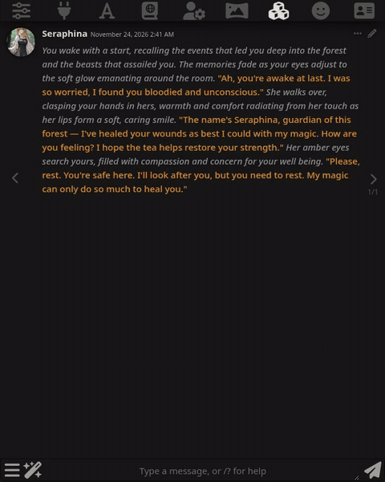

# BlueMetal Music for SillyTavern

Original background music for your chats. Your chat model describes the scene, [BlueMetal](https://bluemetal.ai/?utm_source=github&utm_medium=sillytavern-readme) makes an instrumental track for it, and the track loops with a crossfade while you play.

- **$0.0095 per track.** New BlueMetal accounts get $0.10 free, enough for about 10 tracks. No subscription.
- Each track is a complete original piece, 2 to 4 minutes long, usually ready in about a minute.

## Install

1. In SillyTavern, open **Extensions** (the stacked cubes icon) and click **Install extension**.
2. Paste `https://github.com/1missthesun/SillyTavern-BlueMetal` and install.
3. Get an API key on the [BlueMetal dashboard](https://bluemetal.ai/dashboard?utm_source=github&utm_medium=sillytavern-readme) and paste it into **Extensions → BlueMetal Music → BlueMetal API key**. Click **Check** to see your balance.

Requires SillyTavern 1.13.5 or newer (tested on 1.19.1). Works with any chat model you have connected.

## Use

- **Score this scene**: in the wand menu (or the extension panel). The chat model writes a short music prompt from the recent chat, you can edit it, then BlueMetal makes the track and it starts playing. The current music keeps playing until the new track is ready, then they crossfade.
- **Auto mode**: turn on "Auto mode: follow the scene". Every few replies (4 by default) the chat model reports where the scene is and its mood. Nothing is made while the scene stays the same. When it moves, a track this chat already has is reused if one fits; otherwise a new one is made and crossfaded in.
- **Slash command**:
  - `/bluemetal` scores the current scene.
  - `/bluemetal slow jazz piano in a rainy bar, instrumental` makes a track from your own prompt, as written.
  - `/bluemetal stop`, `/bluemetal pause`, `/bluemetal play` control the music.
  - Returns the generation id of the track, so it works in STscript and Quick Replies.

## Features

- Scene-aware prompts written by your own chat model, always ending in "instrumental, no vocals".
- Seamless looping: the end of the track crossfades into its start.
- Crossfades between tracks when the scene changes.
- A small library per chat (kept in the chat's metadata): play, download or remove earlier tracks. Opening a chat resumes its track.
- Volume, on/off, and an option to review the prompt before each track is made.
- Clear errors for a wrong key, empty balance or a busy server. Failed tracks are never charged.

## Notes

- Your key is stored in SillyTavern's extension settings on your own server and is sent only to `api.bluemetal.ai`.
- Tracks are stored by BlueMetal for 30 days. The extension fetches a fresh audio link whenever it needs one.
- BlueMetal makes music only (vocal songs or instrumentals); it does not make sound effects.
- API docs: [bluemetal.ai/docs](https://bluemetal.ai/docs).

## License

MIT
